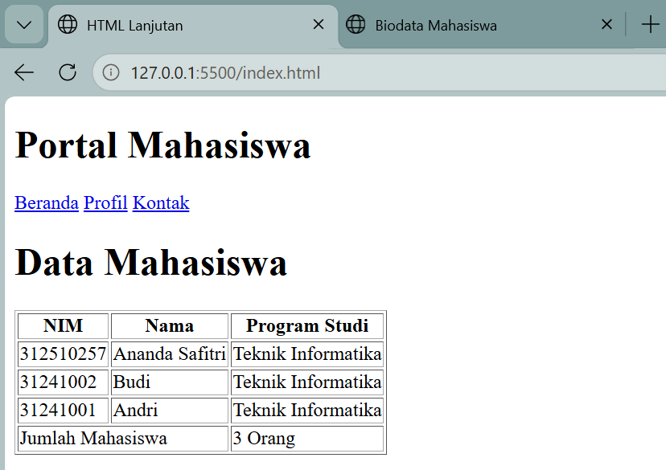
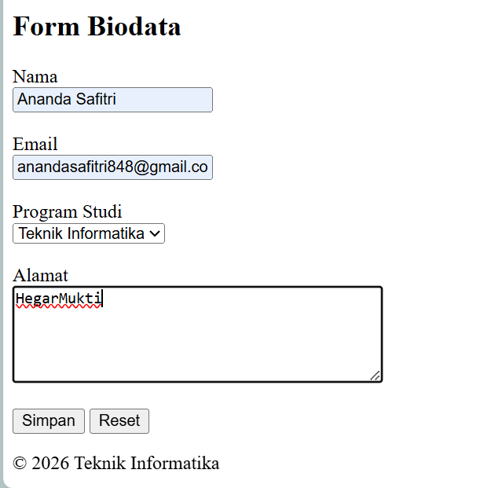
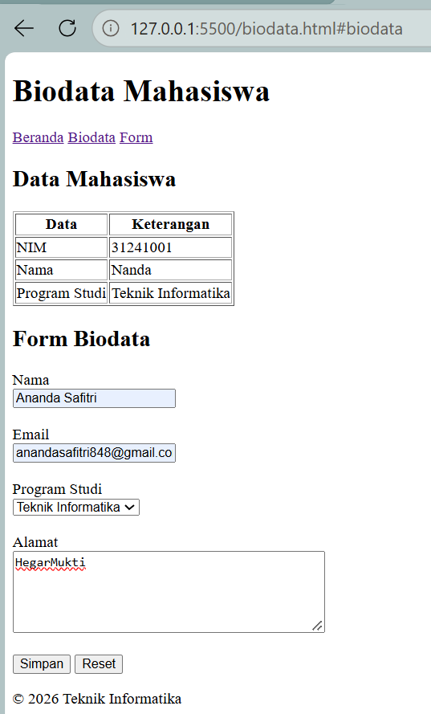
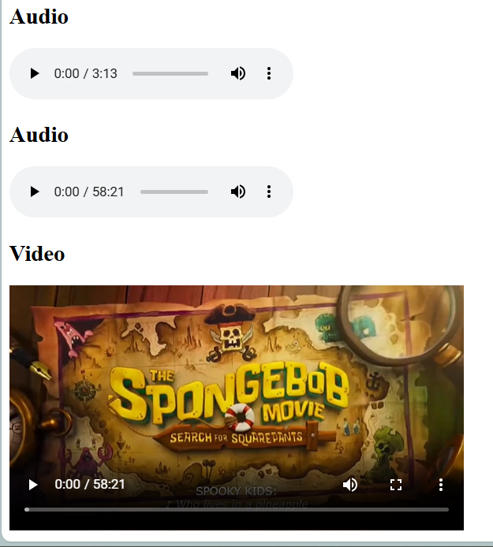

# Praktikum 2 HTML Lanjutan

**Nama:** Ananda Safitri

**NIM:** 312510257

**Program Studi:** Teknik Informatika

**Universitas:** Universitas Pelita Bangsa

## Tujuan

Praktikum ini bertujuan untuk memahami penggunaan HTML lanjutan, terutama dalam membuat tabel, form, semantic HTML, multimedia, dan validasi form dasar.

## Struktur Folder

```text
Lab2Web/
├── index.html
├── biodata.html
├── media/
│   ├── audio.mp3
│   └── video.mp4
├── images/
│   ├── screenshot-tabel.png
│   ├── screenshot-form.png
│   ├── screenshot-semantic.png
│   └── screenshot-multimedia.png
└── README.md
```

## 1. Membuat Tabel Data Mahasiswa

Pada praktikum ini dibuat tabel yang digunakan untuk menampilkan data mahasiswa. Tabel terdiri dari beberapa bagian seperti NIM, Nama, dan Program Studi.

Tag HTML yang digunakan untuk membuat tabel antara lain `<table>`, `<tr>`, `<th>`, dan `<td>`.

### Hasil

Tampilan tabel data mahasiswa pada browser:



## 2. Membuat Form Biodata

Selanjutnya dibuat form biodata mahasiswa untuk menerima data dari pengguna. Form berisi beberapa input seperti nama lengkap, email, password, tanggal lahir, program studi, dan alamat.

Pada form juga terdapat tombol untuk melakukan pendaftaran dan tombol reset untuk menghapus kembali data yang sudah dimasukkan.

Beberapa elemen HTML yang digunakan antara lain `<form>`, `<label>`, `<input>`, `<select>`, `<option>`, `<textarea>`, dan `<button>`.

### Hasil

Tampilan form biodata pada browser:



## 3. Menggunakan Semantic HTML

Pada praktikum ini juga digunakan semantic HTML untuk membuat struktur halaman menjadi lebih jelas. Beberapa tag semantic yang digunakan yaitu `<header>`, `<nav>`, `<main>`, `<section>`, dan `<footer>`.

Tag `<header>` digunakan sebagai bagian kepala halaman, `<nav>` digunakan untuk menu navigasi, `<main>` sebagai bagian utama halaman, `<section>` untuk membagi isi menjadi beberapa bagian, dan `<footer>` sebagai bagian bawah halaman.

Penggunaan semantic HTML membantu membuat struktur halaman lebih teratur dan mudah dipahami.

### Hasil

Tampilan halaman setelah menggunakan struktur semantic HTML:



## 4. Membuat Multimedia

Pada bagian multimedia ditambahkan file audio dan video ke dalam halaman HTML.

Audio dibuat menggunakan tag `<audio>` dan video menggunakan tag `<video>`. Keduanya menggunakan atribut `controls` agar pengguna dapat menjalankan, menghentikan, dan mengatur media melalui kontrol yang tersedia pada browser.

File multimedia disimpan di dalam folder `media`.

### Hasil

Tampilan audio dan video pada browser:



## 5. Validasi Form

Form juga dilengkapi dengan validasi dasar HTML. Validasi digunakan agar data yang dimasukkan oleh pengguna sesuai dengan jenis data yang diperlukan.

Salah satu atribut yang digunakan adalah `required`, yang membuat suatu kolom wajib diisi sebelum form dapat dikirim.

Selain itu, input email menggunakan `type="email"` sehingga browser dapat memeriksa format email yang dimasukkan.

Dengan adanya validasi, pengguna akan mendapatkan peringatan apabila terdapat data yang belum diisi atau format data yang dimasukkan tidak sesuai.

## 6. Navigasi Antar Halaman

Pada praktikum ini terdapat dua halaman HTML yaitu `index.html` dan `biodata.html`.

Kedua halaman tersebut dihubungkan menggunakan hyperlink sehingga pengguna dapat berpindah dari halaman Beranda ke halaman Profil dan sebaliknya.

Contoh link yang digunakan:

```html
<a href="index.html">Beranda</a>
<a href="biodata.html">Profil</a>
```

Dengan adanya navigasi tersebut, halaman website dapat saling terhubung.

## 7. Kesimpulan

Dari praktikum HTML lanjutan ini, saya mempelajari cara membuat tabel data mahasiswa, form biodata, struktur semantic HTML, multimedia audio dan video, serta validasi dasar pada form.

Saya juga mempelajari cara menghubungkan beberapa halaman HTML menggunakan hyperlink dan mengatur file dalam sebuah struktur folder. Dengan praktikum ini, pemahaman mengenai pembuatan halaman web menggunakan HTML menjadi lebih baik.